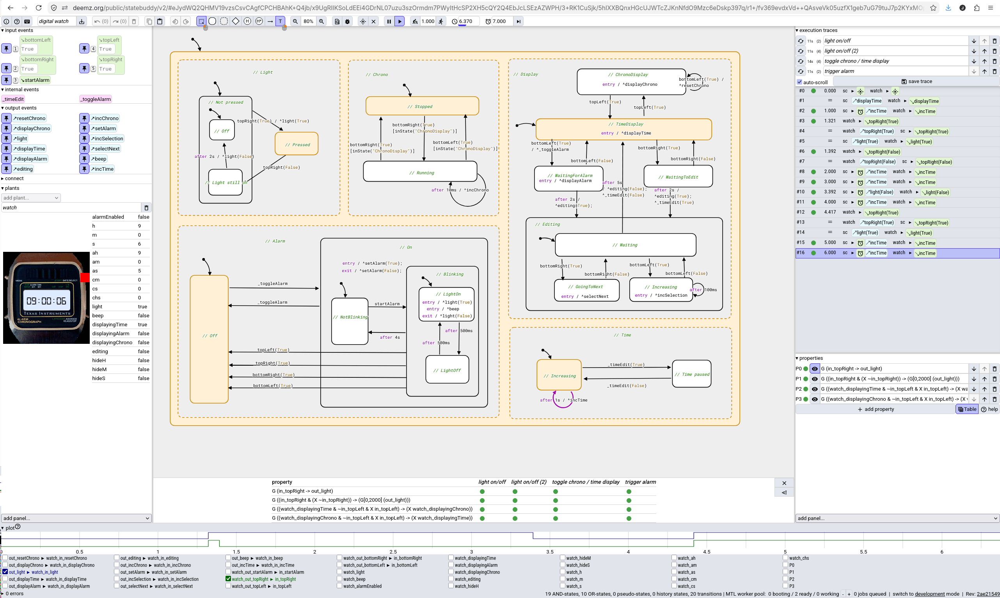
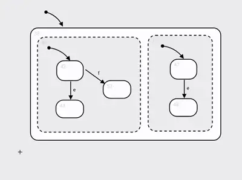
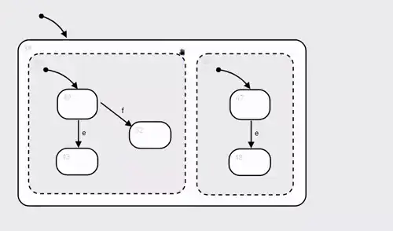
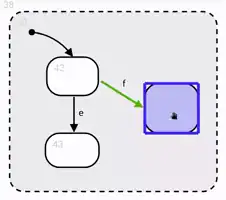
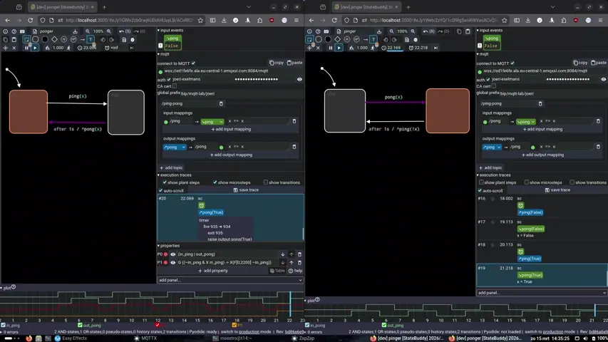

Statechart design, simulation and testing tool, developed with the goal of teaching Statecharts to university students, but probably useful in its own right.




## Features

  - Intuitive editor (inspired by [CouchEdit](https://dl.acm.org/doi/10.1145/3417990.3421401), which was in turn inspired by [StateMate](https://ieeexplore.ieee.org/document/54292))
      - Low cognitive load: concrete syntax is just a bunch of flat shapes, that you can *freely* manipulate.
          -  
      - No hidden information: the parser sees exactly what you see, nothing more, nothing less.
      - Visual feedback from parser during editing.
          - 
          - Syntax highlighting
  - Builtin action language
      - Variables, simple arithmetic, arrays and dictionaries
      - Pattern matching on event parameters
  - Simulation
      - Time simulation
          - step-by-step
          - (scaled) real-time
      - Coupled execution: controller <-> plant(s) (currently 3 hardcoded plant types: digital watch, traffic light, microwave oven)
          - follows Coupled DEVS
  - Omniscient debugging (= ability to undo execution steps)
      - logging of microsteps
  - Live modeling (= ability to edit model at runtime -- use at your own risk :)
  - Ability to save / restore execution traces
  - Metric Temporal Logic (MTL) property checking on saved traces
  - Visual plot of event parameters and plant state over time
  - Real-world side-effects
       - [MQTT](./docs/mqtt/index.md) (over websocket) client
            - ability to map in/out events to MQTT messages
            - ping-pong example (two browser windows talking to each other):
               
  - No need to install anything, everything runs locally in browser

See also the [comparison with Itemis CREATE](./docs/comparison_itemis.md), the tool it meant to replace (for teaching Statecharts).

## Try it now!

<span style="color:orange">*Note: Safari is known not to work 100%. I don't have a Mac so I cannot fix this. Use Firefox or Chrome.*</span>

**Live version:**
[https://deemz.org/public/statebuddy/v2/](https://deemz.org/public/statebuddy/v2)

Or just play with one of the **example models**:

  - [Digital watch](https://deemz.org/public/statebuddy/v2/#eJydWQuQHEUZdh670RjEB8j8IZGFC3iXELLvBymhAiExJZCTC8ozl+nd2d25nZ3ZzMzl9lDwsncJj1IRFYkPENSyAAVBARXFt7FErbJ8wSlFzvjAt1R5AR+l+E/3zvTM3OVCkarc/t3f13///ffff/+9O3vohRtg7mX7686k6apdw3FVV3ubZju6ZepaV6uOuyjV2rtdt1bXzVptj65NzB56YR/MCdMtraa7lj3ijTFrWtVQba22zeyMu47lN7ePu16bDRGnG9Vx29ZMt9HUHRw6Wa+Pu+O2hvCNMCdd37KtcbTDbBia06zpahvndjRX67pOXbVta8LxB+qOZmhVz7i6ifC2zQdWoZL9MCfPNFyrc6FWd2uOfg0uQK/VWmg5ojMwl+ipXXVSKSqXzKIMy04F+XNqpqoijiO9PmU7iFMUlBMgNtQcsWwfA9lWdCqI3wdpk5oNY6IC4t1MOgnEN6j5EKhsVwwGLQPhH2ohMm630qaCcNjDipH59oB0kLG+B8LpaikC3gtinYF7QFirlsOgtA4kkU79DAh3qZWwMR9Qfk0/7wHh7SSTDkM43ylUuAaEj5BMxDMgPw7CEJswp2wmmWwETbwcxA+zhXxb2UYyuSh6sXIjA69SRkgmHwHFu0B4kKGGsolkClH0HuUwA8eUjSRTjIDSCEhbqMUPKgbJxgz+LgjfpOBTyjDJlKJqN4LUpOC4civJlCNgcg0IX+uP3EIylehangPpjRR8XLmQZNNRMAHSmRT8MY7MRn0k/wjk9RR8r0JINuoiSQc5RcGblMtJNuqi5LtA3kDBdypvJ9moh4T9IOzoj9xGshEPKfeB8EMqTKLjsxEfKA+BwGwdRrdnqQumDryZHdbktH+Q6BnyDiGb7K3K+0gpXx8w9EYTu5LTbGl3Kx8lpUJzoKY7HUOdDIDEs8rtpFQyB6pN2zKtzTFY/IEHFxt9OOhPPqU8TErl7inEcl2r7dkxuMMe14ZSG5bvtDXMCudHBySeV75KSpU9mF3sydSG1M6+IXHa3co8Kafb/bUxnT6qPKMcqWbSmdaAabnDOIuj1YKR0qUgSKSc8Vcygio6ITxZAiFJytnFVdNNOoOUc93ViF/i+Y4RlqOpBm9yQ/8IwkZSzhsDrt7W4m6T6iBsJeVCdx3zT1jhlbpJc/Jg1OVDVwfL/CUIl5BySWd7uL1e57P+GYTLSLnoxt24A43ga/kRCNeScrk50Ik76Q8gTJFypbs2vm/HNgvk/4DQI5V0N7VgMBoy6loNvBg24b3S5k7HTbmeVLK7F7iBR9jTlJJ5aa76LQifJJVcV1Hrrmansk4q2K8tquGE5kl+C4R7SSVvh6eJcRLXYaYjlcLu0AJjFOGjIBwklaIVhEmMIF0JwpOkEpyoS8ZNUzcbfI4iCHOkUu4MTKi6i8gWy4457RYQfkcqFdNn7LAuwKucaxgE4Vk8B+nxeBRE9Ci4189Xy8VSm8XRiKsbxnaTq/k9iMtRTba7njmv4Hj76FUNOGd/WRuX48ZibHkGLFjpEyC+ChXkJtj4TLpN3a+b1dipTu4D8TRk5rvr+D4tD6aimx2ZKXbWzgexiMML3ZVHH87D9G8gXovsYnOgz+Cbh3Z8HqFSfUCNuNzzxdcRwCPT9zlf5SCIBxGqNNmYkAfFr4H472omk+4qwU5g5qO7ELcqWQTxf8jNdOKHhxtxMhYFSFnytHwVpNcgByNe6+puZMb+jvEp7wNpJXLzS4Rz4n6QViGnuNSxkB4GaTWSCiZzwXmGbrYifr0OpI1IKBmLZoFEE6QLEC4bAw2LxvPF9Lry7bwciwSEK60BDB1bU52w7uRhkLZXM9l0y48yDDNu2gMgXYVoph0yLbRFyStB2oV4lp8VnGPEr065iQ2QasjLOaGd9EgRS4VrQdqDrPLi65TuZ3Cep+fFrg7xryC9A2mFMaznbTem406Q3o1gsR3oIJrWiczxCcRLrr//i2Y7rDmlTyOtMsb8sq1m8PtB+ilIP6lmcr5LCxGXJp4GaQ7RjEavtiCdPATSYezO6v1zELqWRCy5nkEs12QK86ENugmkfyGUX3QuYS/IxyNaONqtjHVVBfGSGb2VwxeifA4SitbRkof0WZDfioxKOHjDxicfA3lntZLF8PNUDKvj4RtTwIQyWs3k00scysSJIFdxijIrBnbo1ejpmAK5hyqySxz9vzJKpnPUbJsYAPkBpOSc/jnwc6139R9Yz6rCZdMajakqvvi8upBu3HXKWvp5q/IWkq3MIok2vwjCCir8HN8uJJf2ARDOAeH44LK7kOQywRgsP75Hhd+A8E6SywbAQeURpkv5FcnluKq7QbiDSUMgPEdy+QCS1iiPMaGkPE1yBQ5oIKSYVAXhMyRXDCBxFoT7A2mQ5EoBJB8Pwiwb9WUQ/klyZQ49iY8U5kMRxAdILvABJC4CkS01cSGIKslzLyS7+BwMJIQyHLoIX0JM2g7CF0k+y6Fvg/CNQHJInvtC/i8+kQLpUZLnvki0QPgKk9oguCTPveE9dZg3kgPKb0meOyPxJeVpJuBOriF57gssdaRzmHQQpJ0kz32RLID4RyaVQXoDyXNfJD/dfzdB8lMg/pkUuC8Sq7GDSSmQ1pIC90XiXrwhmXQPiH8nBe6LxCEQb2PSHAhdUgj5Yg43jEn/BPmNpBDyxdkgf5BJy0C+lRS4L8QrQKowCdO1SgrcGdIu33hpEhdPCtwb4oMg9Z9wp4O0jxS4N6SfgfSInxJlhRS4N6RbQV7NpA+B9BVS5N7AikB6gql+BKRfkCI/H3eB+Bcq4I25khT5+ZgHaSsbchxI20iRu0I8AaQe5RwBaYoUQydkHcgnUeQ5kE8kxdARGQJ5E0XQe+eSYsgPZ4LcoMjzIGukyN0grQX5hv488g2kyL2QGAWZGZccB3kLKYZi4h0g6/4dLrdIKXQ+vqT8gAmfV+4kJR4R0p9AuI9JWIGmSIlHhPweEM5l0ndAeBMp5abwuvvC1NQ+9v3Py3v0yyBN856J7O8Yz5mziLNO/+nLe5r+/cC7WqGEzXtDd+67Qwr7eZT31Nity4eFqgG/04iWEoEtfkUW0h9UosHYaMkeGB15z/m9mhFdRDv2eA5GR17efq8eFOQS+xLuFTOmijbv0YZtq6PZ7uRYhwm65tRRr+k6LUfdo9V22GpVc1420121NTWom6O+k1Prz0lZ4+4oNWuoey6iEfiM1OBlqetCPUND3pDBrVemz8ym0+mrU4N8+NBQ91JPwYTqVpuj/ZV5VSK6ADX11Xjbja3LUrzJdF6Wig9kaz2aWoa+JMWeRUND7KZdPu17yvuCc9gTt23WqpZpOnsZ45XTRK/VTLWt1dzJDl7IekN3VYNpLWr0ox3pXHYL258VM5ZFv5i9yKppxsWoocXaF3jbia/JMDRGmxQhTjUcAbEZo8GxYgbZ0TiK8eNBRkewSIyvpR+elBGO4LgFkeCm7MgxiNFjR4Ty/YMUo/LzRVk84mM8PfQ2pczgrMaIoTPM7Awf9bid0TRA+aF8EWNHMgnl0lQTY/XTD1tzPznF1xzkrBUzC+YIkhy1JfTMWMANMqfnDZ5FF/D8nOsZFKTfBaxw0vWCIZKDF9rJk7tnJ2/N9AwaUynL3GBhrU5vh+N6muslpJahOu6I3vYW32PQq3oNR297pXOLqI3tdfYzB0jP7mX48T16ELWOaqvtrrImakaQpo7MoiZ47Vl7Z3HE0WnzsP62XidsYGowi5X6cb0ZqiAxdAwFbJ5l3zjWPJS2/NCL0nbCM8e0et3Het1V7OGaYl9O4RPCc1oq+FY4WMJPqLaJRZR5+8OmTN68JImZvyL5IjSt2Lm0Jig92Wu7tt5o4Mun/9XNcb0eHSuvZAtfGR/Mw4lNknj8mMR5OGsNRszNMPfq9xDL1IlttTT7Utsw1XG36d2lVZX+5IZvRLvZUR1nwrJrLUfDZyOTkaQSQzt/E6mqOlEdbYfV0at11/uLOcX7MFgCVzsdzFjtfqZnrXlnwjl7wwbDqqpG03LcsyvpdGZ+1655/D/VTVUy5UouXS6W8qReL+fS9UqmUiClfCabJmpaq+3axcL9Nb2m93PgDswxmPVxZ6uaJzf9r1N3sV/0Xnv92B7d0Ylu6O6kbuD6h1VTM8ZsL1yoWOsYlqvVNDLeYGfPyxAUmaU/Tb5uf62lTTrsx0fOrWu2bdm4XM8V8/PzR47MM8NO6GkTeg09qbta28GXcb/wO7FH78im1u2oWP/VmItStHxxcPdO7Fk6lkG2iZsW6uw7L9zV8K5gzK/zXqN/RSNwAr5Af9jz+kK1Dh3QCX5HTdEVYu+hF6Zh7vV7G9Q5hvfz54E1MHfSgdP0oGpphYqb7smH99/GssHh/e/H/wdoXJ1Fu3YjxpoB/dQFXf44v90KyyFl3VWBAXQIg9AUhp7G2h4nojls6+msqFnAcaqjYdop2F5krlF/LjPKN8J0M0q1F8646DpGY+tYaGNowgajOF1ah/ZvwtThO+7guvqdXVpqhioPZN3OWSEgruv2hbrCdofxJexGWtixA4twnv34nTdFSENxkyljUZtPDdscpflGr+ZGRwlLWP2hRyMGhdeNUFQDGc6S4RwZTpPhTPcMro2nVV9fKCPTf/P9Dy9B0DRxpP8H/7FSWJlpOk1r4rzzrC4Vtto6rh6F8zXDcBqetG2z0+dfD3OwbwwztTVStS3DqGOeQfvG2jo2R1yt44zRhEDFFp5209G9g+8cAXGWqcC6feW03vaL6yZmGEfD5Fy7xrLa0WqdsU+ebnuJ8yLKw2FWG4t+QwvaJk2mQbPOqr+GaXnZuDHGjVCu+D/uAamy)
      - Note: this is the solution to the [Modeling of Software-Intensive Systems 2025-2026 statecharts assignment](http://msdl.uantwerpen.be/people/hv/teaching/MoSIS/assignments/Statecharts).
  - [Microwave oven](https://deemz.org/public/statebuddy/v2/#eJyVV31sI0cVv9k4V0hpaXt87Oj+wCIg7mhLbO+H7atSiVzaU0TvLiKhtBx3l327Y3vj9a5vZ5w4haJcnF74VFWE2kpUtND+0X+gQCU+/kDVFSSkCloVhESKoEZISEUChJSooogeb3fs3bWvqoSlZN/M772Z937vzezb3VevfJH2D1yq8Q1fWF2PC0uwu1nI3cB3WZfZHYGS07oghFNzfcdZc9n67qtXHqB90msyxxVBuBTZ+A6zPStkzoLf7ggeDIenOyIaSxOlV7c7Ych8UW+4HE03arWO6IQM4S/R/sROMww66Idf9xhvOK7Vwr05E6wreM0Kw2CdDw1dzjxmR87VfIQX5r+Ka1yi/dx2XQTtu1hNONy9D/13HaeJjiO6TfuTW1bX2lDvUMUuynTyNar8FUpF20IFNI0nlU+oD8XCxItUeQZKJQjCFGTqXyT4GCUPQknLgOqK+vUYI7+hyg+gpGexLiX/leATlMxAyciumrtMiSbRWyg5DCVzZM8/UmVXbvoB9QSUyqPufpmSe+ItnlT/CaVKFlR/RJWfynWvVc9BqToCvqi+GT9/ra6DVhiBXqLKIWl3o3ovaKME5X5HyfOx2j3qLGilCNySCT7Yu4p9SfRjQxNTBdAw1oM9GdErlMzGQEU9D5r+6GG50DXJQnEGowqQ/lTURSiXPCyhcCM/kxezhdt2UXtAnvpdKBv+tHVeuC12PEClwEvg3Cn1h1Ap8mk437LqPkPQH9chO+o+lPXuPBZZe64jROAfWQ477OjUGdePC/3IdGJ8ulY7enZKOpE/h3W6jLvOu7ztWRtHxNHUsdxJSg6AUW5OO0EQHvcCzpwEnLyXkhNgVL3Mwn5qalGyAOUqOyNuL5xNpifup8QHs3gBD2woso6m636WkhqYWvfwkKzIxZPDPca0c3VKtqBS6E6fEfnZ2XzhbMyudtvU2wWm/IGSr4BZaI2QkroAlNwPpo4udF1xlQd3Wh7PuEBsSh4H0+Cub0cbvnVULiXPQtnsfsiqCRbmizz2U9xafCtPh2bqa5RcBtMUo0uPOZCboOQFMEvt8eSnuyNLV6BcHssG+QxVPgom5pe3LM+bZ7h7ajNHlVugXBEZYs+Frl+fY16m8D5NFcxzsfvBtLTFzcW3rysyT5WHwKw2JRdGodDiaYn8girfBMMMopo73WZXhYvZUZ4Gw/AThdFgCd47L0G5MFi9OLI6maXKK2BWgumaxcWCb4fMwsTVU4VjVHkdytr/FVBukypvgFGRByXyiTnfkDfCO3osrnUbXzXDe0W9oJbj5zOqD5qxi0qyLLfUH0vhWfXPoJkJMGlRpSMlmyq/Ba2cQBM/x4CkdJkqi6BVUuhmSj4vpZejgtaqCZT7GSU/kdBMVJh6IXXiEUqmpfQCJcugF4eQ+nv1V/Hzivof0EuJBcGzzqWEB+d10LXE4l+UvDkUPge6ntrcSZUgKYbvg56yQJ6nyt+k9DgyAXrCg/owVYqx8EuqfAT0lAVySv23FL5NSRH0lITcnyh5UkpvUPIc6CkJkx+j5GUpfQdffmCkJEx+i5K/S6lIyT/AKKbQU1ShQ+qUQ2CkROSmKFmS0nOU3A2GlkIHKXk0gR4BQ78o6+Odo2+M+J0fL/49qnwYKqU6b+DRDNafUJc28Tch24Wpbd/CLmKNLYZBm4ViY7UtBZfxGpanL3iTW2vMWQ4tm/EDF7vGifyRlmtjL4LT54dlmr/19vwX0unkNvxkx/fxVByVPl7bG64Z9SyLkbgwz+zA9/kginf1AJ33rRZzxEabrSZLFtxETCWyI6O4bjsI4j7rJPZd3im0bsrxHWt4+NCBLLQaD2MEuO2PnsbMhmPILu6C+l72Bs9oj8wPdBvDWy6j10hvvuu2s/NDJiO7oTym08y87FAtOxzTbI3c86g7OjGmvZre96iaGW0ivQ/S/vVfA+yGIQyaLPxU6PlWRzSQPde24ua4w1nYaFucrweh0+SMLQ5kVLLAY8c/DrblgsXZctB27ZqI/iNd0cOTubHabaSlNUiiHO3xdX5sZsYLbMtrBFwcqxYKxb2VlT382+zmDdswzWpV13SnpJm6XavY1VJVc6qmARVmWCsrsuV991YjatyXseCaIcNM2iyS64N2ZkW23jfsrK653AXXc8WG6+EpWrR85q2Gbr0hRaftBYI5DDp1zDGu0sAAYmQ3/oa48ZLTZBtcfiWkujWGbXuI0UZM7MU/6ddNW2zddZBIV7AWx3tsW84f2oorv8G6bewrmSMZyrOoXvn+LuKB6+P7yLe87OSAu+xUPTpY+I2Ag5vwEr6+F01mznes1E4+cvJxVHwvmh0c0310qUf777lYj8nxou+ULdp/76Y8du/bbvBGsD43F3Rj4UToOm4kHMf65vVIWpjng5B3aP/9D6xi6QRLWHeeV8PIkVtZhkuCtflqvGksNtEXn7uRW3wfm969/T15P6g9tzU8yA2MmTOsFue+IGilt4LUpL1WlMaTsQ6aoIbjeCwZ+3Fqk2FNfk/V/UA0sPiinl51/gfCXMOg)
  - [Traffic light](https://deemz.org/public/statebuddy/v2/#eJyNV29sHEcV787ZKTXQlrYpOxFqrzKkiVDw7d2tfRcXCdJAcNM0UWIi0dDaM7uzd+Pb293u7PnuIhQ5thMn0IAKqaBSPzRV1SIhIVD4WImiAgK1RVUrEBZIOQmEEAg+gC2VD1V5O3N3u3s4EpHie/N+77158/7N7OaNDy7h3i0XHdH1ItJxRUQidpqFgvseZx1mtSKg7OZTUWQ73LPtZc7amzc+uIB72lqD2Tzyw1OxjmczyyUhs+e8oBUJf7A83oritVJBazWrFYbMi2p1LkC16zitqBUygC/jXm6jEfot8MOruUzUbU6asLdgEetEwiFh6LfFQJEL5jIrds7xAJ47/E2wcRH3xtZrkR88ypzIFvws+M9tuwGOA7qOe+OrpEO6+oM63QQa7+I4N00MiwAOmjFPr+hnJZb7E85NkCL1wwGEx8w+hr6Ec7eRUgrTT+tvSUj7HUYvETOj9ijWDig9HaNDpJwG0V+xdq/SzGH0CTKd0bQwOqfAv+l/JDPpDc9h7X5J/F2/QirpI2DtToz2SOx93aZG9nxfw+g9SdzQ69QoZBTH1jF6V5n4tP4IqWbA3G6MrknNF3RCjWJWE9xZkeA1/XFqlLKae7DmSfC7+jw1yjF4XlXErrX/SZdUGb+GtWelyqz+CDXM72Elf+tQXmY2rgzl71H9KC2ZUIdR2M1P5a24jliY/2z+gLEJWirWXf1FWpp2Ji3fjSPZZ48T/WVamlmalEq23/aGkFbBmklLFXsSSjlReBVr87RcaCyEDKpznjdZYg1tYI3TstHJB77LLTYX+xG2gig/NfHkgs0FoS7LqOg/w1pAS9XOVN/7iSdBLHBJ9ySzZ0Ep2WV2IjmYURjumath7SotF5dHDXyFua7fHsqNvYW1V2i51NkzFBxYPk3cFtt3wNifOfufabnMiRNvaBTEENoFpbqLls3OA2ce4J7s/31xhPY/kTZ5JGQsCWXuOYw+Q8vTDWXOLBSaicGxdzHaS8uV5s4B+gVGX6Rmoa5Ui4ne+NcxOk7L1c59Z27ux8lU6nKzGB2jprGjF1odo5O0PNMxRuMoj/J/pQI9g9F1ahb9kewnmxzF6FVqlnYIa45h9A41y9Ho9o/5Hkti9R+M/k1Ns3P/TZLY9yvJ5PgvcU6n5kznvv6eItMhfSppFP0dnHuQmtOdvTvX0+xNChlrf8CoRM2qM1nL5F6bwrlb6XShNtmVBr6jmvlDawzumzCy4PYYdL7+bf0h+XtdP0ON6U0QUiZghlxX1FcxuosaMwl0ASM1e97D6F/UqAwQ/Q2Mtgcddp0a1SHwff2f8vdNrO2mxcKQ/5yuJtxr+uu0aAx3yF3B2uuKehqj52mxmEAHMXpRUdAvb9BiKYEOY+0hRS1irUaL5SGEprB2WVE9rD1Ni2YC/QWjn6tz/QqjX9NiEoPxH2L0vqKu4twnaTGJwRjMy2OKeg1rbVqsJNCbGHUGlNajxWoCXdL/oYgfYO1TtFRIECjjVxT1Y4zepqUkGOM/xZoxpK7SUhKM8R/B/aeoLkxbWkqCMf4brP1WDY8JjFq0VO7fALdlJ7q8q+Xpn8foJ9Ss1ESdxDXzgv65lZXz6hqfWJVyjMUDT/0d7beNTZBSUHNkGA75mbbZgd8fYAN+IzNQBlw3PSJSwpnWHXCXksGeU++VD697BJ4xy+xE6AcsjLpLgSI4Ew6IepFoCLLM7PmQWEzccj46kj+3L35Yefm9edlmx739KpQfWRtoxE+iEzE5d5hZvueJfrA/ukYhxh5pMjvqBnF3E8fhVt7ltXpUcPtLuWpmMO2Scvf2dd+XL7pj8MJzHwNDDbX+Qnw8j3tpaEkuJUKFlTr7yL4pZBN2ANlsykbER/OpNDLJHNUYyXRWQ2buZhr9tEqNdAGMyGdrQ0pnCmM00tmiUdZTFTNqPVNMt6+PwKO1D8ZGWSuQvmdw745vUXjX09BvsPDLoeuRVlSHzbhF5DO/JVhYD4gQbT+04UjsRJ8GoXjaP/x5ahFOiWDzfsAtJ4r/wsnjH1flngQB92rNfpH0V2lIeBlMbIm2ODg15foWceu+iA5WCwVja3FxC/6vdPJVp1qplErVcqFgUZsVp82KY5ZNk05Xi07VKIDQihoKd67W4y+UeSj9RsggXBaL6cVF9XHxsY2lZS445S6PutyFeXOCeMxdCuMQStIOXD9iNqOtGovibqvDwSSyKb+S7rpoN1hXqO+gRNaBCPshRCGO0Jb8pxy6e5W1uQ0B5hFrChia64p/z6psvjrrBPAQZraKXF4OCAH31T2rPo/z5hE3zezHNM2qxb0NX0GwuBsm5uXVmBkMP9vy8hRKtD8ZtsGFNdzbfb4mg+HGX15XcO/eb4TcWxipmbjTF1KVJ9epOg9SuCzkp9ICkhOmJ8qCnFbtDCsaiooMX70TggwPhh4NCjvoy66Wgd/e2t6W4YdR9fH1uqj77UOH/I4kjoQcnAXiYbAtajE1d1j007WBe/qFJWgH/5QV+q7rQNbA/lKTw/JUxAKxJAMoyQa44Akeh1hsY+33ygSMV7zGm4PhV4d8CQZVbp/1/WZ2mirpPWvNuAyPSTlQ85swm102XHuyNIdLR33x1jw/qkPjDO5F/fH/Avgxe6Q=)


## User documentation

See the [manual](./docs/readme.md).


## Building


1. Get [bun](https://bun.com).
    
    Alternatively, nix users can instead just enter development shell:

    ```
    nix develop
    ```
2. Run:

    ```
    bun build
    ```
3. Build artifacts can be found in `dist/` (`index.html` and a bunch of supporting files). Any static file server can host these files(*). Nothing else is needed.

(*) The only requirement is that the static file server sets the `Content-Type` HTTP header correctly for JS and WASM files. Most servers (e.g., Nginx) do this automatically without any configuration.


## Development

StateBuddy was written in TypeScript, using React as the frontend framework. No frontend framework was used, just plain CSS (sometimes a pain, I must admit). For the model editor, no drawing library was used. 

### Application State

The entire application state sits at the top of the component hierarchy, and children components receive their relevant parts of the state as properties. Children also receive 'partial setters' (setters that only update part of the application state) is they need to update parts of the application state.

I avoid global state management libraries such as Zustand and Redux because I prefer an architecture where component dependencies are explicitly determined by their parents. Rather than allowing components to independently reach into global state and decide what they can access, I prefer parents to control which parts of the application state are exposed to their children through props.

### Persistance with CBOR

The entire application state is persisted in between page reloads. To make this happen, it is CBOR-serialized (+ DEFLATE-compressed + base64-encoded) into the URL hash. The reason for choosing CBOR over JSON is that CBOR supports structural sharing (preserved in a round-trip!), reducing data usage by an order of magnitude when working with long edit histories. I do this with mixed feelings, because CBOR is a much less established format than JSON.

### Statechart Language

The [statechart language](./src/statecharts/), which could be used independently from the frontend, consists of:
  - type definitions for
      - [concrete syntax](./src/statecharts/concrete_syntax.ts)
      - [abstract syntax](./src/statecharts/abstract_syntax.ts)
      - [runtime configurations](./src/statecharts/runtime_types.ts)
  - and the following transformations, implemented as [pure functions](https://en.wikipedia.org/wiki/Pure_function):
      - [parser](./src/statecharts/parser.ts) (concrete -> abstract syntax)
      - [interpreter](./src/statecharts/interpreter.ts)
          - initialization (abstract syntax -> runtime configuration)
          - step function ((runtime configuration × event) -> runtime configuration)

The action language embedded within the statechart language is parsed by [Peggy](https://peggyjs.org/). Peggy turned out "good enough" for my purposes, although syntax highlighting required more boilerplate than I like. Further, Peggy allows JavaScript code in the grammar file (a feature I have used), which can be considered dirty because now the grammar depends on JavaScript.

For MTL property checking, an existing library was used: [py-metric-temporal-logic](https://github.com/mvcisback/py-metric-temporal-logic). This library and its dependencies are loaded into an instance of Pyodide (CPython compiled to WebAssembly). Compared to the rest of StateBuddy, Pyodide is slow to start (2-3 seconds in my case). Pyodide runs in a pool of web workers, so it doesn't block the main thread (or the DOM). Each worker contains its own instance of Pyodide, so spinning up an extra thread also takes a few seconds (to boot Pyodide).

### Philosophical Reflection

My biggest frustration with React is having to manually specify which values/components to memoize. It feels like something the language itself should be able to figure out. If I were to re-write StateBuddy from scratch, I would probably give [Elm](https://elm-lang.org) a try.