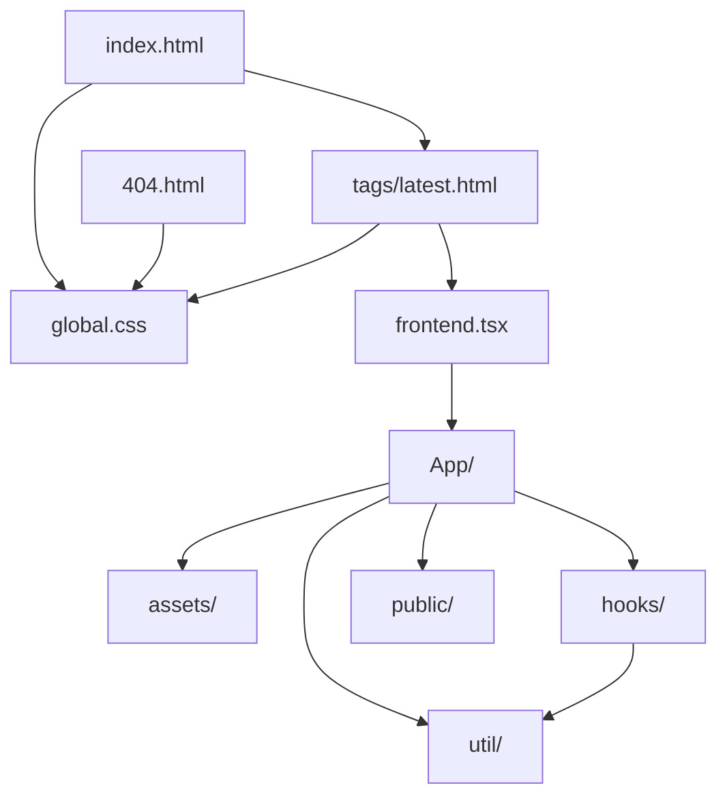

In this directory:

  - **index.html** website landing page
  - **404.html** website error page
  - **tags/latest.html** React app entry point
  - **frontend.tsx** React app entry point script
  - **public/** Mutable files fetched by web app
  - **assets/** Immutable files needed by web app
  - **hooks/** React hooks used by web app
  - **App/** React components used by web app
  - **util/** Utility functions used by web app

Dependency graph:

