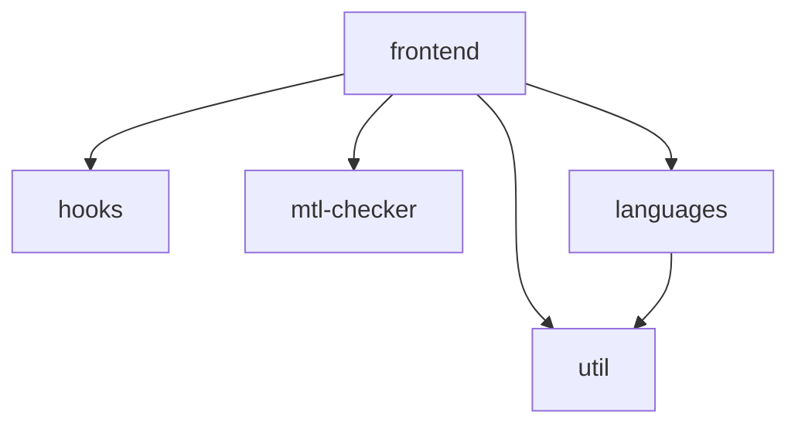

In this directory:

  - **frontend**: React app
  - **hooks**: Custom, reusable React hooks
  - **languages**: the (standalone) modeling languages used in this app
  - **mtl-checker**: a web worker script for checking MTL properties
  - **util**: utilities (no dependencies on React)

Dependency diagram:

