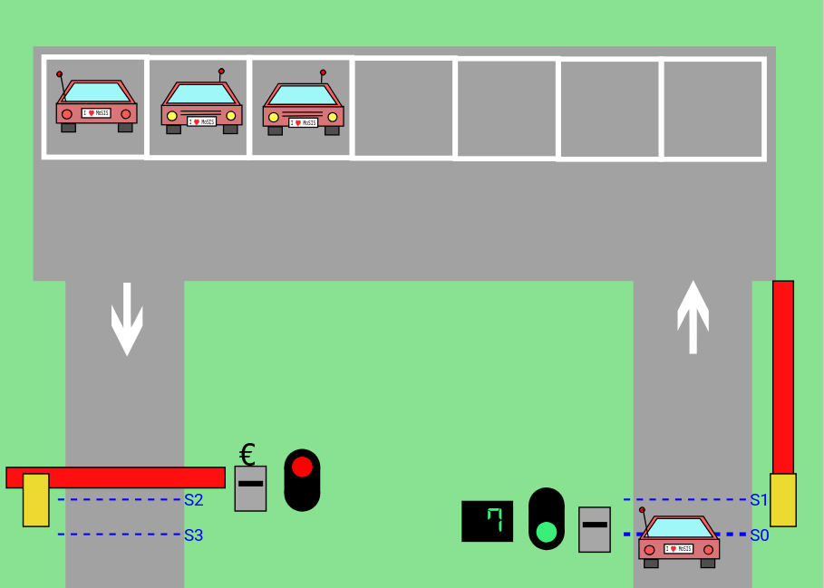
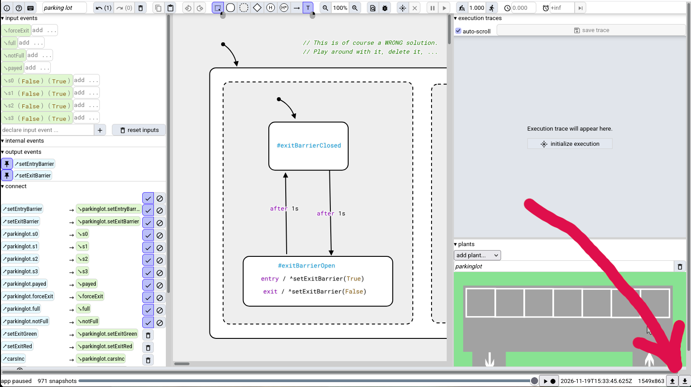

# MoSIS'26 Statecharts Assignment

## Changelog

    Fri 20 Nov 2026 13:45 -- Initial version of assignment.
    Tue 24 Nov 2026 13:20 -- Add clarification that Exercises 1-6 do not have to be handed in.

## Goals

The goal of this assignment is to get hands-on experience with Statechart modeling, simulation, debugging and testing.

## Exercises

Before we start with the main assignment, you will start with a number of exercises.

#### Exercise 1: Nested Timed Transitions

Observe the following model and simulate it for a few seconds: [LINK](https://statebuddy.s3-website.fr-par.scw.cloud/tags/mosis26.html?spy=1#eJyVVc1vG0UU95bSQluglC8PXPYAt0pJWj6aHlBIg1CkBiIlReJA5dmdt7tj785sZ2ZjuxccOx9tQIgDnIm48gfAf4GQuPgUXxEXDkY55BDezNiJxY2VvPvmfc785veeh0enT8motp9rQw18DkpzKRLdFYZ2WMIF49CBuDKoZcUjY9gWh3YLGDdSbdiQi8Oj010yCgaCQZxTBWxVlJXRcrr8rDJ2PRvT6/mgC4M04xq13TSulAJhkqQylQJrx209s8815BDb6i0lK9yUSHPQGeO0wA3paXhClZJtDQY6RicC36srh31MskdGF3fiirPUyPI+JIZp/hhYCw9G59G+Q0bP9mmHdutr9fYQZRIsk6CIpBpiIL1lVfVtElxzwo/1r2IqWK+34/d/aWBTA0KnTAyYcsG5qfqH7vtTvRyiD73tVt/Wf3Hf30lw2anfdctjEhz4wu+Q4L4zvO/XGQn+9NL3JPh515e87Eoye9Dpkeh7j2hiQIULOpwLH3IhQPm4t0lghhhCP5h43HIesjJTj0MS/OY87nQac3Phx50yp1yEJoNQRgZFYOEZAUKjaAw3r7QzHmchzTGLwNvUYQSmDeDDXPkQUQpdGRsjNLfhvuIlcuGOq7gosKD3dtxzaPyB+FtrtDBvzT7Fufmv+g9Xe/7anutnlp6bCERLAW47Bis3GmjeJ6Pnd/GOMZgiebZA+M+6kiUo022WXuCgE4wUyE5Nt4Bt2vNpD/SVAbjjMsMLiDnrHPu6V/uOPanmhbUkJa00sFqtNuH0tcE0paXhuhVXVyCWQuhe4Ij/DRm9cBBJwSMlW6AeqFzQCqEThsfUNRpmVFlJtW5LxVoaYH0ioxONcrj3URRTHlENm7LkcWLsW491W9+dm8tlTPNManN3cX5+YdxojPFn635NRi8+TXSsZJ43t7jmEc+56fIcObROBeRNxdPMi6zMpQEGUZV6GDKs4SxQSEZzj8VL/cR3tffxyut97mvg3ppesiyt1YZowvfR6RMyenmPtaCr3YSZqZUA9rHCPranHLvHo3pjMNk4tDlDrLiBQvuEJPhuz1d+pc9Mt4QMOiXyD1jTEQcZCDAeojXndjKFgHww+h+rkY4jguazykK6iTWrSu394RxyaSb3i4Ybg7Mt9K1lhlfOs/xP62DM0emAjF7dTh3+uYWsT0av9fyoen0n05lsLy/LjhM+UZxxK9yDPNeplVZX9AQVJPkbu01kjtxwyCSICl5fs+C43DBQ6qbbqBNb522oxyS4eQZsfcDxQiH/lBaQ4ck1rNGSPZay6NQFTjbsf0tzNtPHkwYhg8IyZ83FYApZ4FzK4WwtHJvOlomf5KmQJuMidROszjweb267nmJCCovIARm99eR/z/vzvwpZUEyXbkzX226Wz9sJcrK0cb1mn5Olh4dO8NrGrxPtF387wY/5bTuOo9uLbvY8OFlaH82EfDlNNBGwu4//BfUqJyY=)

Why do the `inner` and `outer` output events alternate?

#### Exercise 2: Hierarchical Priority

Simulate the following model and raise event `e`: [LINK](https://statebuddy.s3-website.fr-par.scw.cloud/tags/mosis26.html?spy=1#eJyVVb1vHEUUv80HgRAgBAg7REKLKNIg2+cASlIgxwlClkiw5AREAfLcztvdududWWZmfXdpON85cRIIoqGiIKJDAomPAjoE/wESFFd5exoKRylcmDczZ+coOel237zf+9r3NeOt3dukbmzm2lAD74LSXIpE94WhPZZwwTj0IK4MclnxkTFsjUO3A4wbqVasyqHx1u4NUgcjwSDOqQK2JMrKaLl3fKcy9jytMxh4pQOjNOMauf00rpQCYZKkMpUCi2NYBze5hhxi672jZIVBiTQHnTFOCwxI76knVCnZ1WCgZ3Qi8Ll06d4GGrlJ6kMbccVZamT5NiSGaX4dWAc/jM4hvkHqw0Pao/3wctgdI02CRRIULanGqEjPOdaB70nQtlT4Y1jFVDCHzTvOOgmOOeKr8ON96KxX+ym846AfwsxCg8GG/+xHRjYiwIwrEwNG0nRiKnzDvb8OyzHK0DPu9Fn4s3v/QYIjlt1qzvk4IxLE3s83JPjSQ00P3Q3/8sh34W+3vc8jziezCdpLRas5T8HLvRj+PkaRVvPMhBPcJ0HXs17tXZydjd7LQETcVjaCNSxUdBpORzLGsumZmZmjBgsRGUWF5rZYEZ5o3qV9HcWZ1CDOez+nwrve6GsGbWJOIiFN5JSlgInQERJc8VKvd1DqzV6ZUy5e8nHV5MDLHjwrEORCgIpc77os/Yn18/A5C8vK/Af+O/zCofNzDNELzuTBY+Gvntm0zEXPPEyCb08OfIc8OszsJFzF3HUUYDQxWHp1FeFNUj92A9sJ/VDsU0yNfy0rWYIy/XbpCQ46QU2Bg6DpGrCrKA7a1+boCIw9MsMLiDnrPfB+Hx+6Rk01LyySlLTSwBqNxmR8jo32TNqOX7bk0iWIpRB6ELgZ+5TUT9xpScFbSnZAXVO5oJXBUhoeUzfTaFFlJdW6KxXraIDlCY1CtJXDxQutmPIW1XBVljxOjH3qbd3V52dncxnTHOtrzp+bm2tur65u49/6/YTUT95OdKxknrfXuOYtnnPT5zm23TIVkLcVTzNPsjKXBhi0qtSnIUMfDoFCMpr7XDw1TPwC8TKeeXzIvQ+Mre0p29iNxhghfG7t3iL10zdZB/raLbMpXwngylC4MuxXbrufz+qJ0SRw6HKGueIGCu0NkuDzm97zM0Nm+iVk0Cuxi4G1XY/hBABsjxHNp0ZF37cc6XpE0HyaWUi3HKdZqa0frjxnZlJfBE6M9kMYWmSqr5xkub+mI5cg1NnaHZH62fXU5T+3KRuS+rmB34onNzKdye7iouw54i3FGbfERchznVpq6ZKeZAWb/PkbbewcueIyk2BWsHztguNxxUCp2y5QR3YergG9TYJX9hMbjjgWFPIrtIAMv1zDZVqy61IWVcZxfFScYVfmUam4VNgtXouMCts1l508qssC11gO+2fhOmn/mPgLI8W9knGRuoUXMp+LF9bdPDGBuwY5d0h96tb/vlYe3kiyoGguXdk7r7vd77bzzsLK8Yb97Sx8eM8Rnrv6y4T7/j+O8NfCulveZ9xlE17bWViup1Q+2DM0IXCyH/wLH+FN+A==)

Why is the transition to state `A` always chosen?

#### Exercise 3: Non-determinism

What happens if you raise event `e` in this model: [LINK](https://statebuddy.s3-website.fr-par.scw.cloud/tags/mosis26.html?spy=1#eJylVc1vG0UU9+aTjwIFStiBVsofAErcXmgPKE0joUgEIiVF4gDKeOft7ti7O8vMbGz35Hjz1QASJy5cKjghgcTHhROIPwIJn7J/AgdXPeQQ3szYqUG9ICx5/OZ9zvzm954Hp+f3SVU7SpSmGj4AqbjIQtXNNO2wkGeMQweCQqOWpZ9ozXY5tFvAuBZyy4TMDE7PD0jllRmDIKES2HqWF1qJ8fb9Qpv9ZEyv54KmyijmCrXdKCikhEyHYaELCXtoPyHV9DFXkEBgqrekKPBQWZSAihmnKR5IjcNDKqVoK9DQ0SrMcF1fEylt8SzaGid4UGLSQ1LN7AcFZ5EW+bsQaqb4PWDoyOgy2vdJNdunHdr1N/z2AGXirRIvDWjG/rw6wFh602qnfiBe00j+T34xYX3LWX/2T6zxRz82xl6vdBeeK01tQKylDgBr1q2b9N+2v1/7uckzVzbqy674l8RjLuW3xPtqbKw74+f+H872vf/7PtpsiXlbghkkxnds1K9TcJ6+/6tJMo9Jbox1C8STI+X1Zba0tHjb6qcv+b+N1XWjXnXqWeJ9t+Cgeqr/Dxhduodk6hsj1WoDy62nj/7HI+KjGVgtGk94kmukVjOLZxBGaJ6AJ1qnzDK9b9YZs8yaZc4s8ws9d5Nn+rEh+zYWbUnIExqAkXd20HxEqmcPkCEaJMVb7ELmfjalyEHqbjN3AgcVYmSGXFd0F9g2uoNyr3KpBG22TPMUAs46j1zd5/qWe5HiqbGEOS0UsFqtNuqQ58txSoPHphHX1yAQWaZ6nm2jz0j1wklDZLwhRQvkXZlktNAx9hIPqG1bzCjjnCrVFpK1FMDmSEYn2kjgzu1GQHmDKtgWOQ9CbVY1VG11a2kpEQFNYqH0rZvLy/Xhzs4Qv6bup6S6fD9UgRRJ0tzlijd4wnWXJ8iGTZpB0pQ8ip3I8kRoYNAoIgdDjDWsBVLBaOKweLEfuhnhfJzypT53NfBsTScZviG50GQpdkyqlw9ZC7rKzquJWiEgoSQSytxyaD8O1Svl6ODQ5gyx4hpS5RIS74tDV/mVPtPdHGLo5Eg1YE07IRe1BBgO0JpwM+cWAfmg1UOjEZYjGU0mlamw829SFZn3w4awaUbvi4Yr5cUR+sYywSvrmV9M4kULEMacnpekWtiLLP6JgaxPqld7btD5+7GKRXt1VXSs8I7kjBvhDiSJioy0vqZGqCDJyUETmSO2LDIhooLP10w5brc05KppD2rFFtbPFDdHUUPivXEB7GslxweF5D2aQow3V7BBc3ZPCGx0kb3JsLdlyjOuUuf/epkavmxYTwwUKY6uBC72meXQxTZ0gyTKhI5xtJsR4DMHwtU920gMy4D787h2/J+nzeNB9e8/j73HY+hsZetyzXzOVj5+YAWn3fllpP3wLyu4wb9nJ/YN+6/h3z1b2awmQj4aJxoJ2NKP/gb9wUS9)

    BEWARE: Non-determinism is a run-time error in StateBuddy. This prevents execution from continuing. When a Statechart model is deployed into production, you want to make absolutely sure that it is free from non-determinism!

#### Exercise 4: One transition, per region, per event

Explain the observed behavior when repeatedly raising event `e` in the following model:
[LINK](https://statebuddy.s3-website.fr-par.scw.cloud/tags/mosis26.html?spy=1#eJyVVc2PVEUQnxkQv0ARBV/jRzbRownMwq7Awayw0WwisDoLiSbi9ntdb6Zn3nv97O7ZnUENs29gF9AQEw9qJIbEi/+ACTEe9OjBP2BPzMl49LCExE3E6q6ZYRJOTjIz1b9fVVd1dVX15p3719igtJEYyy2cB22kymLTzSzviFhmQkIHorZFVKQfWytWJKy2QEirdM2Z7Ny8c/8KG5T7mYAo4RrEQpa3rVGj5dm2detJm16PjCr9ekMaRLv1qK01ZDaO27atwfEY1o4NaSCByHlvadXGoLJ6AqYhJE8xIDMyj7nWatWAhY41cYa/C/O3ruEm62yw83LUlqJuVf4OxFYYeRFECw8WVquocJkNHil4h3eD+SDZRJntOMAqNyOeiU00DavTDgw+CC55sqxY5dNQaeKOEPZX8BkJF1jlkxE5c9wb3mYV64UbwfJ409mjXr+yyCorD5HV14mssfKvniyC82NymsL5jZV/foirzpLhGVYuefJS8N4DQx9r8EvwzyTV623QTezquyQBFoG2EWSCV73aWwH5Wwlwl139cPoYudDBHyTcCLaJoNP+GfxOmSgFdz1+1McU/MvK7xJRZuWfPDMzPOZXrHyOpG/8oZCaPUy6O1glIGknuiRqhnS/Y5WDJN3EBK/TIR71hxCuCEbXHc5Mc6A99rHy2ibqhDPHhlDlB1Ze99BsdaS1l1XeIGg6ekVXh2DwLWFHEJsm2++DrwmbHe32I6vMBad6VFSPFQ3XPUsYS0tDnvAInLy8jPQGGzx+BUvQguZY2yuQ0d+iVjlo223mJEgwMVpm2DyGr4BYQnUwdNYn+mDdUliZQiRFh9w+WRDcSrixNZkuIVsQtbtohbx+Nqb2rBuZOtM1IvcUIuMpQM41/r1qoo/gHhbR7gJTtqcYASVSfqrwDTTaIs5524AoTZWGbf10fxS268RFJy7MQ6SyzPTKvve/YIO910OVyVCrFuhzOsl42zZwAMiI+1mDO+pGzo1ZVVq0DMDiUEYlHiZw6s0w4jLkBpZULqPYul+zZVbNiUOHEhXxpKGMPXH88OHq1vLyFn6d38/Z4JlrsYm0SpLmijQylIm0XZlgqSzyDJKmlvUGiSJPlAUBYbtOOW2gD89AqgRPKBf7ipgGG+kQ+GwhyQfG1iTJFSPmDymfxats8Ny6aEHX+CE74SsGHGUaR5k75Zb/UFb394eBw6oUmCtpITW0ISt/uU6eDxTCdnNoQCfH9gbR9GN9ymqArU1kE+lufwqw5qy56xDl6zDjySSYKj+0J6G6uz8cxX6b4f0isb8/DqFwzETtes18/HxM+QShzZ37fTZ4fq3u85+4lBVsEPRoWrPLDdNQqydPqo4X3tZSSCecgiTBqkVpYd4Ms4KNdPBKEytH1XxmYswKXl8zlbisWchN0wfqxRb6z4x0oZgtVn5tnNgX+hIvFJIzWPkNPLmB0zwXF5VKM5W53I3MSP3FfurK5bRXRDuV4sxJYLzOfAmNlzG9YPVM2YbM6n464TT1SXhpzTeScH4Quc4GL1/93+/cgydSpRy3q9dG6zU3+bkfpttztb0l99meu3DLC4Qu3x6i7//tBXoU1vysPUIz/dz23OJgwuTD0UZDAVv63n8J14/k)

And also explain the behavior of this model, where an internal event is raised:
[LINK](https://statebuddy.s3-website.fr-par.scw.cloud/tags/mosis26.html?spy=1#eJyVVd1rXEUU37uptfWzVlvv+MWChSoIyaZtbPuUNqkSsG00aUHBNnPvnLs7u3dnrndmk92qNNlt0zZKEUSqItJ/Qijigz4K+gfkqfskgiA+pBQMWM/M2U1C7YsLu3vm9ztfc2bOmdXb966xXuFKaiy3cBZyI7VKTFtZ3hKJVEJCC+KmRVQ0PrBWzEtYqIOQVuczzmTb6u17l1kv6CoBccpzEFMqa1qjB8vTTevWW20WF8mo2K1UpUG0XYmbeQ7KJknTNnNwPKY1dEUaSCF20eu5bmJSqpKCqQrJG5iQGZgnPM/1ggELLWsShb9TkzevopNl1tt2KW5KUbE6ewsSK4y8AKKOG4vKZVS4xHoPdXiLt8PJMF1FmQ3tZcVvYq7EKppG5VEHhu+FFz0ZaFb8KNI5cQcI+z38mIRzrPjhgDx0xBveYkXrhevh3KbT171+cYYFP3qyE57dIEcp4k8s+P4/XHmMDE+xoODJi+E7m4Y+nfCH8O+t1OLiMhV7e9fVAfCccxuDErzs1d4IKd58iF62d6PRwxQiD38l4Xq4TgRt6LfwZ9psIbzj8YM+p/AfFrxNRMCC7zxzqL/Nz1lwhqQv/aaQGhsh3SFWDEnahiFXKNOHfabCHebg2KKDh8XwcOkY6RZZ8OoqqkUHjzj0OKE7WPCnRw+NOHSCQn7BglcILTt0ktCvWfAHoaMGSsOlc+elspArnp6Yx2tIDnezYImUxloTaHuilaVcqpKtQklHFkUQpY32KNmcx1BaqIIq5VwaqSol6VqhBOiytB/2k9df2NA+8npYPSBq8QYLVjw/Vn4QH+xkxXHiR+OX8zKBu8KvCDuA2Cg5+ja8EY4v0h3f0am6Zp7FktZzwG3E4OS5OaSvsN7Oy3UfiWOrYST6m851Brlt1zISJJgELRX2suHzIGbdfg0d2SNd8NsXVjYglqJFYR/tEFxPubEzsjGL7BJRj3XqEa+cTmhaVIxs2E3y8Y5QvAGQ8Rz/9pn4PNwtFIh7ouPbd2CRZLxpQBRKhf5QebI7yNLNgWknTk1CrJUyi4GfPJ+y3q6VSCsZ5boO+Zk8VbyJh6qsjLmfdOgxr2bcmAWdi7oBmO7LqMSjFCaORTGXETcwqzMZJ9b9mjWzYI4OD6c65mlVG3v0yMhIeW1ubg2/Lu4nrPfUtcTEuU7T2jzekEim0rZlihd8mitIa7msVEkUWaotCIiaFSphFWN4Bhpa8JRqsbuT0FglHQKf7kiKgbnVSHIthPVDylfxKus9syzq0DZ+xG+JlQAO0hwHqdvlmv9QVfd0+4nDghRYK2mhYcghCz5bpsh7O8K2M6hCK8PJA6LmHxVsDIC1VWTTzX6w5o5D9OCCbwUb2j8ZW6GKOz98CLyb/vkisae7kULHMVuuqtfM7utOtLl9r8t6zy5VfP1TV7IO64WL9FawS1VT1QvHj+uWF97MpZBOmIA0xUuK0tSk6VcF++a5yzW8OXrGVybBquDx1RoSlzMWMlPziXqxjvGVkS4Vs8aC1zYK+3xX4oFCegovehV3buAkz8QFrRv314b0X+g23H056TXRUDdwVKawsVb+Dm0sE3pAK0rbKk4kP1Rx0vsqvLjkO0korVwdVljvpav/+5ndfKF1g6O7ysxgveReJe4H/fr4zK6C+6yPn7vpBULnbvXRd//yAj1YS/6JOEDvzZn18eneFpP3B476Avb03X8BYCm6gQ==)

#### Exercise 5: Order Of Orthogonal Regions

The order in which orthogonal regions can respond to an input event is explicitly controlled in StateBuddy. Regions can be assigned a "tag" (starts with a #). Regions are allowed to fire in the alphabetical order of their tags.

You can now explain the behavior of this model: [LINK](https://statebuddy.s3-website.fr-par.scw.cloud/tags/mosis26.html?spy=1#eJyVVc2PGzUUj7flaymlLV/j7oFIhRtiN9m20EpFpa2oVqKwYtsihFqtM34z42RmPNjOJtlTNmm7bQGJKwKhqoL/gVMFFyTEAQ5cIiQ2BxCcEEKLeuhhsf2SNIdeiJTk5/d7H37Pz8+DrZ0bdFjaTLVhBi6C0kLmke7khrV5JHIuoA1h01gpzz4whq8JaDWACyPVijPZPdjauUqHpJ9zCFOmgC/lRdNoOV6+3TRuPW3T7aLRTD9OhLbSThw2lYLcRFHTNBU43m5r16bQkELoojeUbNpN5XEKOuGCZXZDemweMaVkS4OBttFRbn+XztzatE6u0eHuK2FT8NjI4k2IDNdiHXjDJlarVKzCFTp8qMfarBPUg/bAYrprkc68HLKcD6xprVJ1wuDj4EtPEknJnzWpkFv0spm54DaSlyn5Y0K+gmRMye/exS/BuxOvVfT6MyVbHvwYXLwf8SgaGkpe9OR3wTv3DX3I4CdKnp/mut1NrOjDfZcs2MNUJoScs4pXU8Fr/v92UAysTq3yKqZ6gJL2BP2K1DEM/wUlvyH6nJJ1T1UPY5otSjJE65QMkDqCgj3ejUOzlBikMNbMV8E/CL6lpIwMhiI0+AvBIiUHb2Aij/hEuDvQ8dHVqgvtOSNj2wHl941sQH7ixMKl8vws4gomQin5dGDNa9VKMVIeayxg/FuU/IAaRx/gb3a+PO2PbFLymddeXJC2QVWnPFZAdyQIGPKV9JCqnJWg3xBKm1GuwR0kq9khVXXkCoTSHabPN/gG2UU5P18W5YStATpH6+/pzH5UOPxABXKEzuxFhSMPTpaUKLkTvNDFTn+0l7grfd4WtaGgSFkIDq+uWnqTDh+7au+FAcXshVuDHP+WlSxAmU69QCBAR9Yytzda293w81YdNB7abB+MW3IjMggFb9/FuI/3/I2LtcgcExWsqYGXSqXRHNjTH7t0V3fZwaUzrk657hI/LD6iwydu1mQuaspmpy6oNGdNk9gDESHzw8l6VEnBtG5JxRsaYHmErRKrpXD69VrIRI1pOC8LEUbG/ept3dLH5+dTGbI0kdocP7awUNleXd22Xxf3QzrceyPSoZJpWl8TWtREKkxHpLYfl1kOaV2JOEHIi1Qa4FBrxliGxMbwDGSSsxRr8WQvwkmIOijc1xMYw+6tjsh1fKk0sJT93dq5Tof7r/EGdLSfylOxIrCzT9nZ57Lc9h+s6oH+aOPQEtzWShjINDqk5JNrGPmpHjedAhJoF3aOAK/7d6BsFMD2wLKpcNO8DLYfjP7XSaTvkZyl08JM+ik/LYrd+dnZ7d2MztcSB/qTLfQcI9aYEm7raFVMnpuyr4+Vbu306fDpjdiXP3UV69HhM12c7s9eSXQiW6dOybYHZ5XgwoHTkKY6dmjpjB4Vxfb4c1frtnHkii9MZItiT6+eCbtcMVDout+nhw0bP9fCbUVvU/LSpK5BX9jzhPQtlkFiE9dwjhV8XcqsPWf7DVRZRmWpTCJj6cqkIHY+0Jj2M9c757yZ9SIzO+VSmKxz30+TZYTvX5xLk4g89vMw4FiSgxv+VvFc5q4oN+lw7vr/fiXvP7AyY9ZdvDJeb7gHh/kxcu/kyr6S+9w7efmWByhd/Xokfe9vD/Ap2vDDfdEP9+DCvZPLwymTS2NHI2Dv993/AA85mCg=)

#### Exercise 6: `inState`-function

A special function exsists that can check if a certain state is active.

Run the following model in real-time, and raise the toggle event a couple of times: [LINK](https://statebuddy.s3-website.fr-par.scw.cloud/tags/mosis26.html?spy=1#eJxtVT1sXEUQzjom/IeQAHlLgyULCSr/JU5ikAhJJGJBwFIMCIUf73s77731vXt77O6d74IQ5zvHjkMKaJCoQEgUNAgKBFQkgpIKaFygXIEQUEXIUYoUYXbn7uSCk+692e+bndmZnZm3de32Rd7btV5YJxy8AsYqXaa2VTrRlKkqpYImJHWHqKy+7ZxsKFgZ3bp2+wLvsW4pISmEATlf1urO6sHypbrz6wpI5bQ5602327RppJvlyiLaypK6MVC6NK27ugHPX+K93RcrRtfRfZkVYHOpRBVd28GmVBijVyw4aDqblvicP6UsFJD4I+qqqKgyOztYb6LNdd4bXUvqSmZO116A1EmrzoNEPRlPz6LCGu/d0RFN0YqmIrmFMh/dy0ceT0SJq9E1MRMw9lH0YRBG1jn7JdbGc/H0NGEb0eek5Tj7uE+KQx6KFqOLRI1x9vuAom27E84+CUqrkR76m/TIrePvuF3+d+u4PR0EQpe+66OvXQ/CcNdU32J0NRjsROmQmg3I15x9H4QiyofU4YB8GfXCO6VN7fYm3dWers8bYGkYlwDma+YYhXLl1nH91Y5TvbvdP5X5o4/u6YqgG13u2/4iuu7ReGqSTDDO5kka4ewbokIM0U+cfRuEHzl7nojDlOVnOHuLwnw9+jcw03Q5I13OmiSd5qxFFG3aPRf9SsKb0W9EHAnWN6OJ/sHOEXyUDDzF2We04VXO/t6gTNwZMiF91Q3KSByJx0Ww8CdnB7ZQRRyNx+OA/MXZPx6Jp6ZTpzOsZAr1IGcNwmd24NEPnL1H8GxDpA7M2JQdO6fK0DhPjIsn36CjXeFsPOhNH8oHesQAZxuBmZn8PwvxwMLPnF2NHvv0Zpvq/q5O7nt8EcOqGKgVIgEvLy0hvcF7d1/ALkFjApupASW9FoyugXGt5RoJCmyKO0tsdysaIBdRHSyl7Z4uOL+UTlUhUbJ5k/ze2wn9l1lV9UxaE3ULEgunPyTu6w5M+g5f8OL8KUh0Wdr2rjBJLvPe/ZdiXarY6AqYl01RirrLcZyoRIRphRZNXhPWrmgjKxZgoS+jkogLOPlsnAgVCwuLuqYSvA982m27YucmJgpsxyLX1s0dm5yc2l5a2sa/9/s+7+3dTG1idFEsN5RVsSqUa6kCK2JBlFAsG5XlJMpaoR1IiOsZpSFHH4GBqpaioFw80ElpTJIOgfs6inzg2ZZJ8jXnO2tfB59haj+4LivQsmFM7/CVAo5IgyPSR7kdfpTV/d3+wWFFScyVclC1ZJCzp9fI84GOdK0a5NCs4SgAWSg/2scA79/ZG1vI61ATpSh2glUdRv5OSDWEUf4Mfrm/O3B0ctWTteFnZSyEjTrXbnd576HVLGS18Ino8N7DbRrhj6zlNtcrJ07oZhCeM0oqL5yEorCZl+ZP2X6sGMbBzjLWgz4b4k0xVryUG5x9QJmIugpvAIoXRRVyPLqFM6Imz2tdzfo9Q3q8W/UXeyZo4AZdxSFQwHBdhsseLlP6EGWldjl+hsK4wE9KCOzR1VDystQl/AfCrTFB)

Instead of having 2 outgoing transitions with the same trigger (`after 1s`), it is cleaner to use a pseudo-state (also called "choice-state"): [LINK](https://statebuddy.s3-website.fr-par.scw.cloud/tags/mosis26.html?spy=1#eJxlVU9oXEUY72yj1aq1tWrfqIdAERQPzaZt2hShtS1o0GqkUZD6J/PefG/fZN++ec7MJrsVMdlNk6b2oBehB1EED4KIHkQ9WVEEz3rJQbIHFfHUQ4qHgvWb+XaXoAu7+83v9/2fmW/WN25e5L1tK7l1wsGLYKzSRWrbhRMtmapCKmhB0nSIysbrzsl5BQsj6xs3L/Ae6xYSklwYkFNF2XRWD5bPNZ1f10Eqp81Z73pxkYwq3VqmLKLtWtI0BgqXpk3XNOD5Nd7bvqos5JD4iHWjm5hIUcvBZlKJBiZhB+apMEYvWHDQcjYt8Hfq9Idr6GSF90aWk6aSNafLZyB10qrzIOtYTDw+gQrLvHdLR7REO6pGch1lPrKLVx5ORIGrkWVxMGDsvejdIFRWOPsp1sZz8fg4YavRx6TlOLvSJ8UhD0Uz0UWiRjn7dUCR2faEsw+C0lKkh/HGPHLjxBtum//cOGGfCgKhs1/30ZeuBWFoVe17jL4LDjtROqQmAvIFZ98EIY+yIXU4IJ9FvfCfktESbc2t3f91La4eono/4mwymByPzi5eIv0dQR/w5BiXAHb34CQVfvXGCf35lhre3OzXYH7rozu6gtxd7mfySXTNo3F1jFwwzqZIqnD2JVGh4ugHzr4KwvecPU3EYcrxOGevkXSFs1mijhLwI2cT1K+Xo38CM06BKlc5WyPmVc5+J4oOQGWJM9rJyknOVomiUNuPRT/3jaJfiDgSclqLDvTLOXeRmnRbaJL0p3TQWXEk3i+C2h+c7V1HFXE03h8H5E/O/vJIXB1Pna7hyacu7ONsnvCDW/DoW87eIngiE6kDM1q1lLLh7HliJhvnVBHu4CP7xaOvUN678XgGery6hY4H9E7OPiX60H/8znL2fvTQIl2j2zuZnxEzWFzdQJmLBLw8O4v0Ku/tvICXDo0F3uZ5KOhv2ugSjGvPlSQosClaFjgurJgHOYPqYKl5d3TB+aV0qgGJkq2/Ke6dnXCda1Y1PJOWomlB4snqD5m7ugOXfi5Me3HqNCS6KOzitjCJLvPerkuxLlRsdB3MCyYvRNNlOI5UIsK0Q48mK4W1C9rIugWY7suoJOIcTj0RJ0LFwsKMLlWCu4K/dtMu2GMHDuR4u/NMW3dscmysujk7u4lfH/dt3rt7LbWJ0Xk+N6+silWuXFvleC6mRQH5nFG1jERZ5tqBhLhZozZkGCMw0NBS5NSL3Z2UxizpELinoygG5jZHkj95/urt6eBvmPr3rMg6tG0Y81tipYCD1eBg9VVuhg91dW+3nzgsKIm9Ug4alhxy9vgyRb63I127hAxaJU4WkLnyT8Mo4P47e30deR3ORCHyrWBDhydjK6TmhVE+B7/c2x0EOrXkyXL4LI2GslFn42aX9+5bqoWu5r4RHd67f5FehH3Lmc30wsmTuhWEJ42SygunIM9tzUtTp22/Viwj6szhedBnQ70p1oqbcp2zd6gTvKtwByB/VjQgw9QtnBGlPK91o+zfpdHHRpNMq7AfaPBAt+F3+ExQRUvdwJmQw3BdhF0fLlN6AmuFdpkqanNYYmGVrxYfrFDng0vhBshCF/AvPsBOsA==)

Both models have the same semantics.

## Introduction to the System

The system is a parking lot with an entrance and exit. The entrance and exit each have a barrier that can be opened or closed. In front and behind of each barrier is a sensor that detects the presence of a car. The purpose of these sensors is to detect whether a car is IN FRONT OF the barrier, PASSING THROUGH, or has PASSED the barrier. Next to each barrier there is also a traffic light indicating whether a car SHOULD pass.

At the entrance, there is additionally:
  - a ticket printer (which we won't use in this assignment)
  - an electronic sign indicating how many free parking spots there are left.

At the exit, there is additionally:
  - a ticket scanner (which we won't use)
  - a payment machine

In normal operation, cars can enter the parking lot via the entrance as long as there is at least one free parking spot. The entrance barrier only opens if there is car IN FRONT OF it and closes as soon as that car has PASSED the barrier (so no cars can avoid paying by leaving via the entrance).

Parked cars can leave the parking lot via the exit, where the barrier only opens after payment at a flat rate of 2 EUR.

The exit barrier can also overridden: a parking lot operator can click a special button causing the exit barrier to open and remain open for a limited amount of time, allowing a car to exit without paying (for VIPs).

### Assignment overview

Your task is to create a software controller for this parking lot, that:
  - opens/closes the entrance/exit barriers
  - sets the traffic lights to green/red
  - keeps track of the number of free parking spots by counting cars entering/exiting

The software controller is only aware of:
  - the changing state of the sensors at the entrance and exit
  - the payment machine registering a successful payment
  - the special 'override'-button that should open the exit barrier

## Detailed System Description

### Sensors

The reason for having 2 sensors at each barrier, is to detect whether a car has actually passed the barrier and not just reversed back to where it came from.

A car entering the parking lot will cause the following sequence of events:

  - initially, all sensors are inactive: s0(False) and s1(False)
  - when a car arrives in front of the entrance, s0 becomes active: s0(True)
  - while the car passes through the barrier, both sensors are active: s0(True) and s1(True)
  - when the car has passed the barrier, s0 becomes inactive: s0(False) and s1(True)
  - when the car continues driving to park, s1 becomes inactive: s0(False) and s1(False)

Likewise, the sequence for a car exiting the parking lot is:

  - s2(False), s3(False)
  - s2(True), s3(False)
  - s2(True), s3(True)
  - s2(False), s3(True)
  - s2(False), s3(False)

### Assumptions

    A0. Only one car is entering / exiting the parking lot at a time. In other words, only one car will block any of the entry sensors (S0/S1) or exit sensors (S2/S3) at a time.

    A1. Cars will never attempt to pass through a CLOSED barrier.

    A2. Drivers are opportunistic: if a barrier is OPEN but its traffic light is RED, they may still pass through it.

    A3. If a car is passing through an OPEN barrier, the barrier CAN close, resulting in an accident. Your solution should prevent this from happening (see Requirements).

    A4. Cars do not necessarily always drive forward: they may reverse at any point in time, but will never hit a CLOSED barrier (cfr. A1)

    A5. A car can only interact with the payment machine when it is IN FRONT OF the exit barrier (i.e., s2(True), s3(False)).

    A6. Initially:
      - all barriers are CLOSED.
      - all traffic lights are RED.
      - there are no cars in the system.

### Requirements

#### Counting

    R0. The car count must ALWAYS be updated when a car enters/exits the parking lot. More precisely, the car count MUST be updated when a car has PASSED the entrance/exit barrier.

#### Normal Entry Procedure

    R1. Whenever a car is IN FRONT OF the entrance barrier, AND there is at least one free spot in the parking lot, the entrance barrier MUST be OPEN and its traffic light MUST be GREEN. In all other cases, the traffic light must be RED.

      Note: This means that as soon as the car PASSES THROUGH the barrier, the traffic light becomes RED.

      Motivation: This RED signal is meant for a potential follow-up car.

    R2. As soon as a car that was PASSING THROUGH the entrance barrier has PASSED the barrier, the barrier CLOSES.
      
      Motivation: This makes it impossible for the car or any other car to leave the parking lot via the entrance.
    
#### Normal Exit Procedure

    R3. When a car is IN FRONT OF the exit barrier, AND its driver pays for her stay, the exit barrier MUST OPEN and its traffic light MUST become GREEN. Then, as long as no car PASSES THROUGH the exit barrier, after 3 seconds, the exit traffic light MUST become RED, and another 1 second later (= 4 seconds since the driver's payment), the exit barrier MUST CLOSE.

      Note: If the driver misses the 4-second window to pass through the opened barrier, the only way to open it again is to pay again.

      Note: This behavior is not very realistic, but it results in a sufficiently hard, but not too hard, assignment.

    R4. Whenever a car is PASSING THROUGH the exit barrier, its traffic light MUST become RED.

      Motivation: This RED signal is meant for a potential follow-up car.

    R5. Whenever a car has PASSED the exit barrier, the barrier must CLOSE.

      Motivation: only drivers that payed the fee are allowed to exit the parking lot.

#### Special Exit Procedure: Manual Overrride

    R6. When the parking lot operator clicks the "FORCE-OPEN EXIT"-button, the exit barrier MUST OPEN as if a driver has just payed for her stay (see R3), meaning, the car has 4 seconds to pass through the exit barrier, etc.

#### Safety

    R7. Whenever a car is PASSING THROUGH a barrier, that barrier MUST NEVER CLOSE.

      Motivation: safety: a barrier closing while a car passes through results in an accident (try it :)

### Plant <-> Statechart Interface

Your Statechart model can respond to the following input events:

  - `s0(True|False)` indicates a change in the s0 sensor reading (`True`: car detected, `False`: no car detected)
  - `s1(True|False)` indicates a change in the s1 sensor reading (True: car detected, False: no car detected)
  - `s2(True|False)` indicates a change in the s2 sensor reading (True: car detected, False: no car detected)
  - `s3(True|False)` indicates a change in the s3 sensor reading (True: car detected, False: no car detected)
  - `forceExit` indicates the parking lot operator has clicked the "FORCE-OPEN EXIT" button
  - `full(True|False)` indicates the parking lot is full (`True`) or not full (`False`).
  - `payed` indicates a driver has payed the fee at the payment machine located at the exit

Your Statechart model can raise the following output events:

  - `carsInc` increments the number of counted cars (potentially resulting in a `full(True)` event being received)
  - `carsDec` decrements the number of counted cars (resulting in a `full(False)` event being received if the parking lot *was* full)
  - `setEntryBarrier(True|False)` opens or closes the entrance barrier (`True`: open, `False`: close)
  - `setExitBarrier(True|False)` opens or closes the exit barrier (`True`: open, `False`: close)
  - `setEntryGreen` sets entrance traffic light to green
  - `setEntryRed` sets entrance traffic light to red
  - `setExitGreen` sets exit traffic light to green
  - `setExitRed` sets exit traffic light to red
  - `requestPay(Integer)` makes the payment machine request the given amount of money (in EUR) from the driver. This event must be raised before the driver can make her payment.

### What is Expected

The assignment is designed to encourage and/or require use of (almost) all the Statechart constructs that you have seen in the theory classes:
  - hierarchy
  - orthogonality
  - input/internal/output events
  - timed transitions
  - guard conditions
  - exit/transition/entry actions
  - (variables)
  - (history: shallow/deep)

Use these features where appropriate, demonstrating that you understand them.

Your solution should implement the requirements correctly, also in edge cases, or events happening in a different order from the "normal" scenario.

There is not a single correct solution and there can be many good solutions. Generally speaking, a smaller/elegant solution (fewer model elements) is preferred over a "big" solution. As an indication of expected size/complexity, my own solution contains 17 AND-states, 10 OR-states and 19 transitions.

## Practical

We'll use StateBuddy, a web-based integrated environment for statechart modeling and simulation.

A starting point model is provided, where all input/output events have already been declared for you, and connections between these events and the 'plant' have already been set up.
It also contains a (wrong) example solution that you can play around with to become comfortable with StateBuddy.

Use Firefox or Chrome!! For instance, Safari is known to have issues resulting in DATA LOSS.

[***LINK TO STARTING POINT***](https://statebuddy.s3-website.fr-par.scw.cloud/tags/mosis26.html?spy=1#eJyVV02MHEcVzq4DsZ3gLPkh24mz7iQkspHxzo9/dnNAE/9gFuF4yI5BCGNvTXf1TM10d/VW1ezOOD+an12v7QQrSBFCCKEIcYgIoIhDhCJLSIgjB24wJ48QQgjlAGJXjtiDeVXVPVMzs5LDyO59P9+r9/p11XuvurfvXrd69234XCCBv4UZJzT0eCMUqO56JHQJrmOnJkDqBstCuCsEr1axSwRli9Lk/u7tu+tWb6ITutjxEcPuQhjVBKcJe74mJG/abGibyQ7GKzgUVY5WsJtHDAW8HMk/hboo8lQbfxX5HLsFVsNLXYAXeXpMRjzKHHymTkQzxmR2sMuOyVyv5vtjUhyhBnabS9chwjWrt6vtViEHOkz9pByLM6FgjZOIMYJZF0BaE0oNxDGmKDmI8YXQGZGcxobEj43PMozDgbgSi1/BriFkeLmGucijxkAYJHGNrFBN5HIJlfb7O6Uy4fAtGiWnxhhgPK8magw3u2ozfGaDcOxjR37zKqM12Aphyce87BIUwDbgibkHL0pXYX1cF9wL4blw+l35ba9avc+uOTXilgSNvoE94XJyBatUOulMSuf2gTaqo8Z2rvDjX8DvV9u5Szck8X4XNNu5m8/O/CD9/n+3c+2tj37/u09+6qAQMgCrHj0xpxEX7fvkbzvnzClCS6/8SDHW5IEiZbHBvFRZk6cB+hcT+o94geYtRfQN5rIasDaTAF7rm1kTX9vOLeUVP4hpLq0tnA9i789oXnwSr/Ddf41aZDTi6gtKMf13zZYjzS4byJRUTf95OxfW+2FM/2bal5BmMz5Luzsy37ApEBMOVnmOY7r4ZJzfb35dEr/UUvSnOLKLS/LvRFeucHTuqNbWNmNtTOg3dyATf4x5hT6mQrlrTe7XZvTt2GzlPRN2XGtv/DxZdJBOkP46SXLBtDmhv9l/rMndGrfxs8TaDGE+Drjzcax9/WNj7fV9ydqHTZtjWht8EGvLU4bN8u5Y6uvt8X2d3z0qv67c6smmhijnysgTmNlpHr9MkrcrSZB75MvMj8A2Poxhr94yYPOpEdjK4Rj22n4Tlh6B0blkNd+EZeozWJ57e9a+NFKzDsp6d0hleNfzcMRumnZZsIOKs5OZKpaHtNfrmdhrp2JaH68/PeR1UA8HTrdzPDmlhdjsBJgZTg0r0ydPTmzn6sDn8WyGP4eNME/5UKPdOMrHvvSeslj+m2mRZc/hgQ/TgE9dyCsD9o5pcHR5yMX5SJZYib/2zzik1iUTfywyHQzg7FYC/9CEH6+fm521C1BXbfhHPduhNcaxjexvv3L+5bM2p75qwUf2Aizvo4aNZGF27VUiyjYRh20XKrbAijxy5Ih29mpy4BZTcbpfb+rau7ddlr29ALu5ynDkIwdLemkJ1BtW78F1KNWwxRD0AOgh+k+e0Qgz0ahEmiCYe2AZQmtX/bsAcMz1aXmog4VkXUEC7BC3fkf7/ZzupyVOAqnxIlSDzENorfqxswcPkvAyT9kv2G9IIh0Tsk8fsr/8FZvWxOWRHXlIu9vXSSKRTSgvyQXorjQMeUsjHu4U4fSGKICQGhH2YcqAQEq2T0WqEjNAVw35xNu6k02tUapGmHMw0vgvwxJVzZ9RTZ+EpqqiWKUpcmeoqQ/5HGn3U2uANnr9cHzmDKCQyUAxBBtMGQMMJGEco+YOhRmeGYaQo+OEjnAweAxHaA4kCmlOHUPQoXFEY0cnqiH8+LilbEZmrSGTsTlsam1ID5MlrADPHTRppUnvoMkoTWYHTVZpsmMaPUuCUhNj+sHkCpgBM4ZTkypA9MTarsA3tOU4yrg+VJ9v68NW9REXiyQowMla06pH2slRqxZR6bynR3Nr18mW1j/aVmcCq6G7bn3RdHtZFjw49A7G7p0uLGXtKbW6YHJP3IP7Ph3uoX/fE2c98od2fUa+MRICB5Hgtm4vxZqwHYZ4GUoOZKCtFnzgJ5/O8d65ezt+9Bqk6C2r99iNIg1JkdEqZheYH6KaKAOQOEjdiaB+MbizcL5KmQubG+djGkCo6ONTLxUdRIqI4wKNiOMJ+eSbfJW/ODvrUwf5ZcrFi/OpVHpzaWkT/ssS/abVe/y6xx1Gfb+yQjgpEp+IBvFh7MijEPsVRkplTboRBI9dXKyV9D4ogw+lwQF1ka+/9Bfanr6AaYwWPtEm2gfEVtGUHGxkW3qiDc/bd69ZvemrbhU3uLoMGr48DMM/9Cgh33JT/XSptTpx4HiVuJArAt+N6wWtiTfWtecn26oOl3E9gikWaoSqm7a6sfCtLuip6kAh8k1hoCuvKSrJMg+XFcWQFcSIDEjqrE7sdfLxjlRG/ZusrXKg7ePOoWijtcmX6Vi9p1ollX5fZuym1dv/FpNtqKhLy0vwXEF+MGgg0L+GuPQQlxnisvWnDFZ1t5T91x9+ZKs2OK5M95Xp5VFdZkySrT8/KoILQ4jd/iqaHfeT6SMy48psX5ndkt98C37w0K3y6bUyL9PVkydpXRFnGXGJJE5h3+clSS2c5vFWgTljZr0Cx4kuqu3iwVaBPV0JCLCLAke8oj6NIqvwxUJO5MfjW9bEAXCqd9uBDgmS5luG7cHxORS5VygNzF6usXYnkAfonEKBEQ1gJvBxnw/Voeqznr4Fl0IqyrCOmv2nXb0vnmmpQcYNaSh3xg2r9+y1//uuPLhm0wDJUBcTviWvfiilx7jFqXiMu/SucU9Z+m0s/c7gatlstuQVp5hVN97pC9u5fM8w+V6yUEw0J5p3/gdVhV3l)

### Saving / Restoring Your Work

StateBuddy records a history of *all* user interactions (mouse cursor movements, button clicks, keystrokes, ...).
This information remains local on your machine (in RAM), but you can *voluntarily* hand it in, as it provides us with useful data to improve StateBuddy (what do users struggle with, etc.).
It is also a small experiment to see if recording user interactions works well enough (for instance, does it have a significant performance impact?). This is part of a larger usability study to improve StateBuddy.

To see the current recording, hit the shortcut Ctrl+. (dot). This freezes the app and brings up a bar at the bottom with a slider and some buttons:

The slider allows you to seek through the recording. In the bottom-right corner, you find two buttons:

  - "import recording": import a recording that was exported earlier. Any unsaved changes in the app will be lost.
  - "export recording": export/download the current recording as a file.

**This is the main mechanism for you to save/open your model.**

To unfreeze the app, and continue working (and recording), click the "resume app" button.

    CAUTION: if you refresh the page, you will keep your model, but you will lose your recording! If you intend to hand in a recording, always export the recording before leaving the page, and import it before you continue working on the assignment.

### Submitting Your Solution

  - deadline: **Friday, 4 December 2026, before 23:59.**
  - medium: [BlackBoard Ultra](http://lms.uantwerpen.be/)

**One team member** submits:

  - Either:
      - If you wish to submit the full recording, simply upload the exported recording file (it contains your solution as well...)
      - If you do *not* wish to submit the full recording (e.g., privacy reasons), and only your solution, simply upload a file containing the URL (including the long hash-string) to your finished model.

**Both team members** submit:

  - a PDF / HTML / plain text document, *individually* answering the following questions:

      0. Your name and name of the other team member.
      1. Did you have hands-on experience with Statecharts modeling before? (e.g., Itemis CREATE)
      2. What part(s) of the assignment did you work on?
      3. How many hours did you spend on the assignment?
      4. How much effort did it take to complete your part of the work?
      5. Was StateBuddy responsive enough, or did it lag?
      6. What CPU and how much RAM do you have?
      7. Is there a feature/aspect of StateBuddy that you found especially useful?
      8. Is there a feature/aspect of StateBuddy that you found especially problematic?

    Elaborate where necessary.

There is no need to explain your solution in written word. You will do this orally and individually, after the submission deadline.

Also no need to hand in any solutions to exercises 1-6, since we already did them in class.

## Problem?

 - Found a bug? -> [create an issue on GitHub](https://github.com/joeriexelmans/statebuddy/issues)
 - Anything else -> [e-mail me](mailto:joeri.exelmans@uantwerpen.be)

## Resources

 - [StateBuddy manual](https://deemz.org/git/research/statebuddy/src/branch/master/docs/readme.md)
 - [Example models](https://deemz.org/git/research/statebuddy/src/branch/master#try-it-now)

## Acknowledgements

Rakshit Mittal for the parking lot idea.